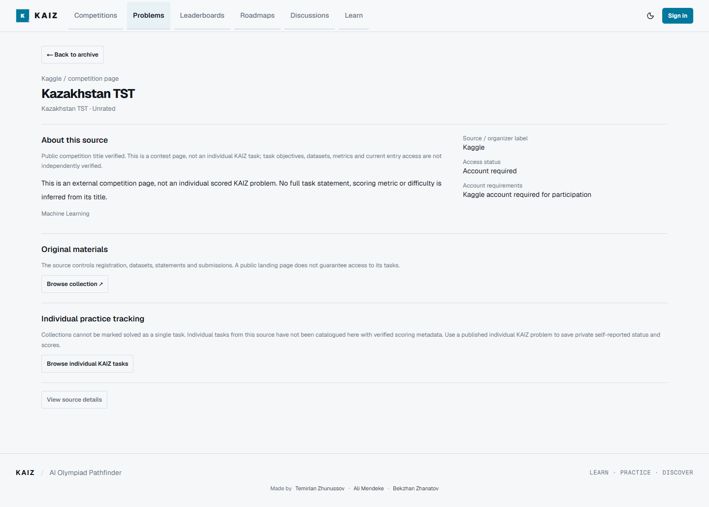
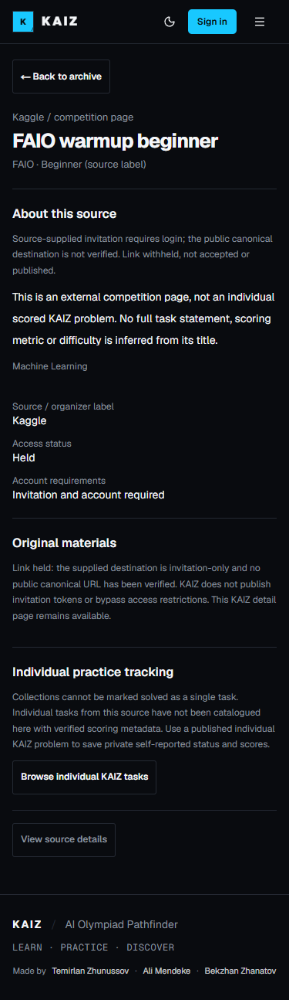

# Archive detail navigation

PR #37 / Issue #35. Every editorial source/collection now has an internal page at
`/problems/sources/[id]`, using its existing stable catalog ID. Published database
individual tasks retain `/problems/[slug]`. This prevents source ID/task slug
collisions and makes held/unavailable sources openable without publishing their
invitation links or importing pretend database tasks. Unknown IDs call notFound,
render the shared 404 screen and carry noindex metadata. Next.js may return HTTP
200 for a streamed not-found response; browser QA checks the screen and metadata,
not status alone.

Titles and View details always navigate internally. Open original task / Browse
collection are separate outlined actions, present only for safe known usable
URLs. Collection pages show parent/child catalog relationships, access metadata
and an explicit no-collection-wide-scoring limitation. They never acquire status
or score controls. No individual task is inferred from a competition landing page.

The existing owner-private status/attempt architecture remains unchanged. My
Progress is prominent on database tasks; status, metric-aware scores, previous
attempts, archive badges/filters and dashboard reuse the same tables and RLS.
No schema or migration change. No new production content/import is authorized.

Source review on 2026-10-17: 28 catalog entries, 22 matching public landing pages,
3 held invitation destinations, 3 exact Kaggle task URLs returning HTTP 404.
Corrected URLs: **0** (no authoritative replacements found). Corrected misleading
generic error-page titles: **3**, now explicitly original supplied source labels.
Kazakhstan TST's existing parent URL returns its matching public title; it is not
one of the unavailable task URLs. Six Yandex collections redirect to entry/login;
post-login statements/access are not verified. Public pages do not prove metric,
task contents, licensing or registration rights. See source-review-2026-10-17.json.

The original publisher selections add three more catalog pages (31 source pages
total). Existing published individual-task inventory is checked separately; an
empty database is surfaced honestly, not populated with synthetic production rows.
NEOAI's seven children remain competition pages, not approved scored-task imports.
No individually verified metrics/reproduction permissions or approved import-ready
tasks have been established by this review; publication candidates need separate
source/rules/metric review and owner approval.

Full stored statement text is rendered only when trusted source_provenance records
statement_permission=granted or statement_license CC0-1.0 / CC-BY-4.0 /
CC-BY-SA-4.0. Otherwise show only the existing short summary and original link.
Attribution/original source links must remain, including for open licenses. This
does not grant reproduction rights or change any stored production statements.

Release still requires the unchanged 202610160001 personal practice migration,
separate owner approval and review. Presentation migration/PR #24 stays separate.

## Verification — 2026-10-17

TypeScript, ESLint, 196 regressions, optimized build and diff checks passed.
Disposable PostgreSQL 17.7 passed 171 SQL security assertions, curriculum registry
and multi-connection persistence/retry/undo checks. The unchanged practice
migration's canonical SHA-256 is
`cdb34ce8ef2b2fc6bd7b68728561b249d309497d2a32dc99d342fd42dea4c661`.

Real isolated Supabase Auth + localhost browser QA passed: archive title keyboard
navigation, status/score CRUD, refresh/new session, filters, dashboard reconciliation,
metric validation, owner/member/admin/anonymous isolation, all 31 source pages,
held/unavailable source gates, unknown-ID not-found UI/noindex, 375px with 200%
text in both themes. Layout assertions wait for actual loaded content, not loading
fallbacks. Three disposable users and three tasks were removed afterward.

Read-only production inventory: zero individual/published problems, five
competitions, personal-practice migration absent. No production mutations.
Physical second-device testing and third-party post-login access are not claimed.

Screenshots show public editorial metadata on the localhost QA build, not new
production problem publication:

