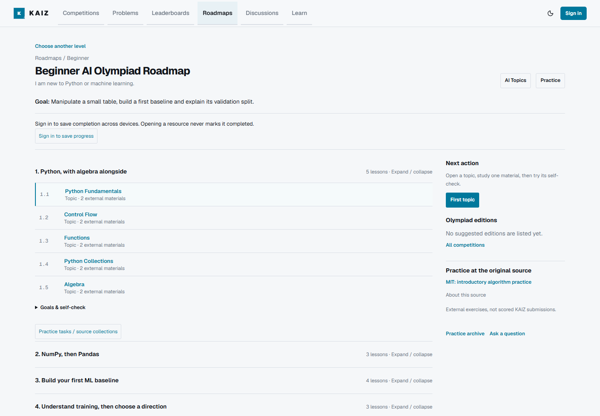
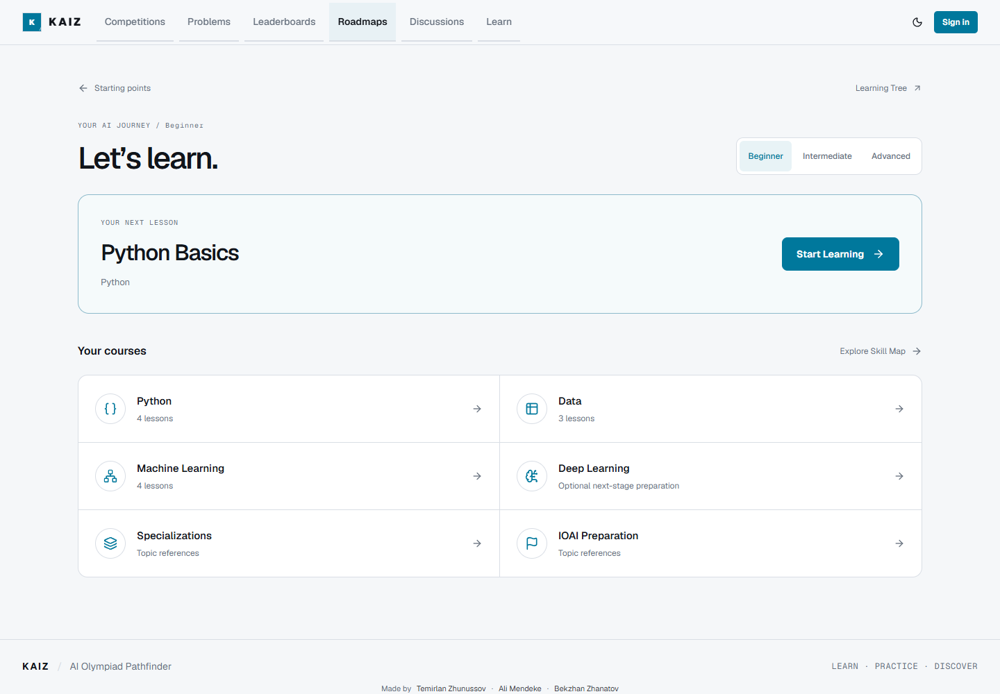
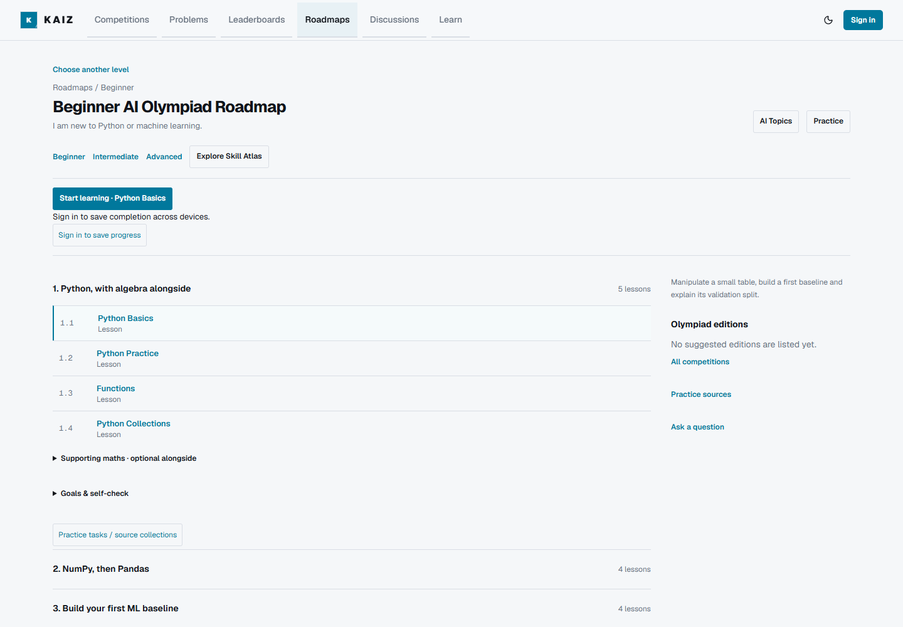
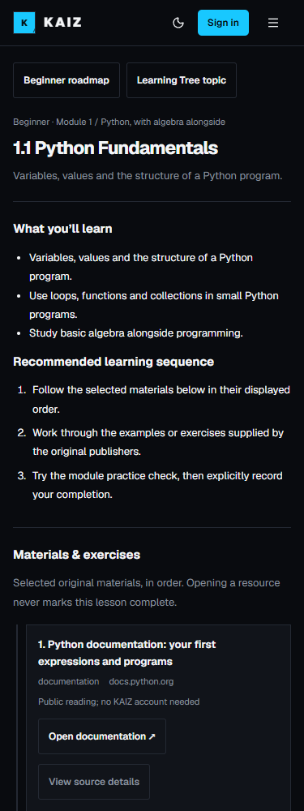
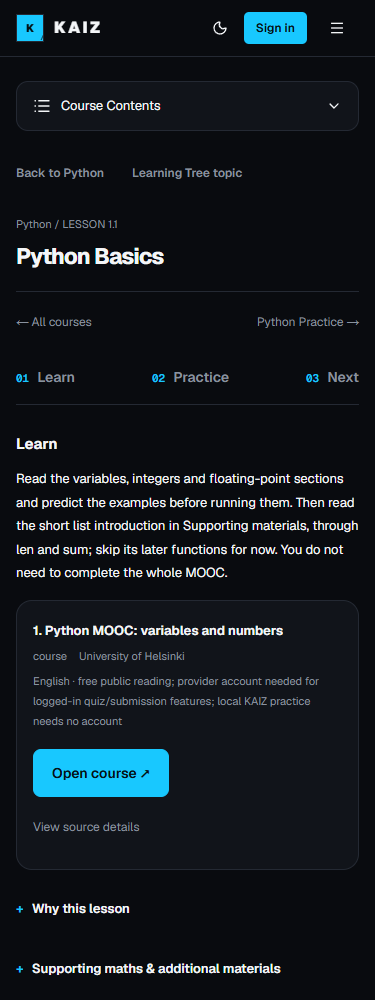
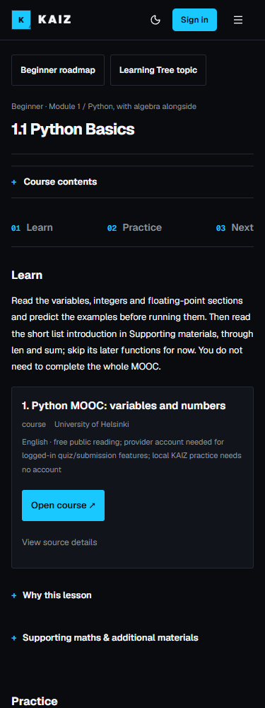

# Classic Roadmaps, current educational content

## Design baseline

The classic reference is `0761ff65e63c122dc1e9c6935e6b2fd009cc14ee`, the first
parent of PR #48's merge `07441988ee6c4d71fa1a280c8c4306a6f2419f05`. This is a
layout adaptation, not a revert of #48. Reference screenshots use independent
local source snapshots with backend configuration absent; no production data
or private account information appears in them.

| Layer | Treatment |
| --- | --- |
| Entry/navigation | Restore three compact level rows, familiar shortcuts, four expandable numbered modules and visible progress. Remove the large slogan/cards and forced course-hub/sidebar flow. |
| Lessons/materials | Keep current guided lessons, selected courses, resource access/provenance checks, assignments, prerequisites, expected outcomes, hints, worked examples, maths and setup instructions. Use the classic single-column shell and compact native contents. |
| Teaching sequence | Retain Python → conditions/loops → functions/collections → NumPy/Pandas → Analysis → supervised learning/baseline → first ML model → evaluation. Maths is supporting study; DL remains optional. |
| Progress/security | No change to the 40-key registry, saved keys, RPCs, totals, XP, owner-only policies, Auth, practice records or My Learning. No migration. |

## Original / merged / proposed

Desktop overview, light theme (1440px):

| Before #48 | Merged #48 | Classic + new content |
| --- | --- | --- |
|  |  |  |

Mobile lesson, dark theme (375px):

| Before #48 | Merged #48 | Classic + new content |
| --- | --- | --- |
|  |  |  |

The complete local comparison has 36 captures: three versions × entry/overview/
lesson × desktop/mobile × light/dark. Selected public guest captures above are
kept for review; the full browser evidence remains in ignored local output.

## Compatibility details

`classic-roadmap.ts` is a read-only display projection. It retains every own
lesson once, orders Beginner's core as introduced by #48, and keeps the original
lesson reference numbers/URLs. The shared Analysis row uses the existing
`intermediate / prepare-data:exploratory-analysis` identity. Its completion earns
Intermediate XP, not duplicate Beginner XP; its label makes this explicit.
Supporting maths and optional DL remain accessible, not deleted or prerequisites.

The main summary keeps the original 15 / 14 / 11 per-roadmap totals and 40 overall.
Module meters count the lessons they actually display, including the labelled
shared reference. Native disclosure state/navigation does not write progress.
Start/Continue on Beginner follows its improved core, rather than restoring the
old dependency ordering. Completed core review does not claim the optional
curriculum is complete. Failed reads remain visible without invented zero XP.

Atlas remains at `/roadmaps/[level]?view=map`, with area expansion, keyboard focus
return and the existing recommendation logic. Legacy `?area=` links remain
reachable through a compact course-contents disclosure; they do not replace the
default classic overview. Lesson contents are a native disclosure at every width,
not a sticky sidebar or a mobile-only JavaScript navigation requirement.

Instructional content files and `GuidedLesson` are unchanged. Compact styling is
scoped to the lesson shell, with only an added practice-container hook. No global
styles, main layout, competition features or Supabase utilities are changed.
Existing Intermediate/Advanced educational gaps remain documented in
`educational-quality-audit.md`; restoring a layout is not a claim those gaps are solved.

## Verification

Use `node --test tests/*.test.mjs`, TypeScript, ESLint and the normal production
build. The existing learning CI step includes `classic-roadmaps.test.mjs`.
The unchanged canonical disposable PostgreSQL runner applies all main migrations
before every SQL suite. The updated roadmap browser matrix keeps all 133 routes,
three profiles, eleven core steps, six optional map areas, geometry, keyboard,
history, 200% text, reduced motion and both themes at four viewport widths.

The opt-in `skill-atlas.supabase.mjs` remains locked to the approved isolated QA
project/local app. It covers real member/member/admin sessions, persistence,
refresh/new sessions, XP/undo/retries and cross-user denial. It additionally seeds
a released-key completion before first UI access, verifies its timestamp remains
unchanged, and completes/undoes the shared Analysis through the classic overview
without duplicating XP. The existing private-practice suite checks attempts,
scores, dashboard and admin/member privacy separately. Synthetic fixtures must be
removed and inventory reconciled afterward; none are production content.

No production migration, account/data/configuration change, import, merge or
deployment is part of this PR. Final results and head-specific CI/Preview status
are recorded on the PR after the complete verification run.

Local verification on 2026-10-21: 261 application tests, TypeScript, ESLint,
normal Turbopack build, all 133 browser routes/eight viewport-theme combinations,
and all 20 authored Python example executions pass. Two fresh PostgreSQL 17.7
runs each pass all 198 assertions (including 25 Learning Progress assertions).
Real isolated Auth/progress QA passes with two ordinary accounts and one admin,
including the preserved pre-existing-key fixture and shared Analysis/XP undo.
The existing real private-practice browser suite also passes score CRUD,
status/undo, dashboard/filter synchronization, new-session persistence, metric
bounds and owner-only member/admin access. All six synthetic accounts and three
tasks are removed; QA users, profiles, progress, practice, tasks and result counts
reconcile to the original zero baseline.
The managed QA project already has migration 17 from earlier independent work;
no hosted migration is applied here. Exact-main dependency/security coverage is
provided by the ten-migration disposable PostgreSQL runs, not by assuming that
managed QA's extra schema is part of this release.
