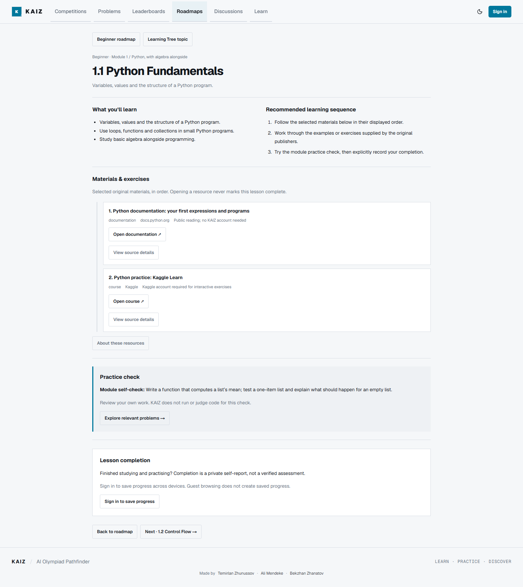
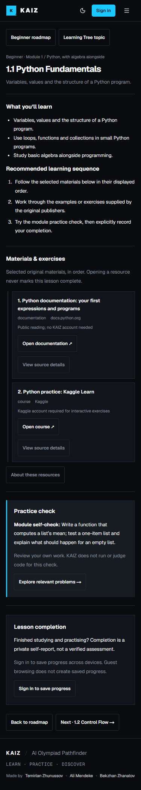
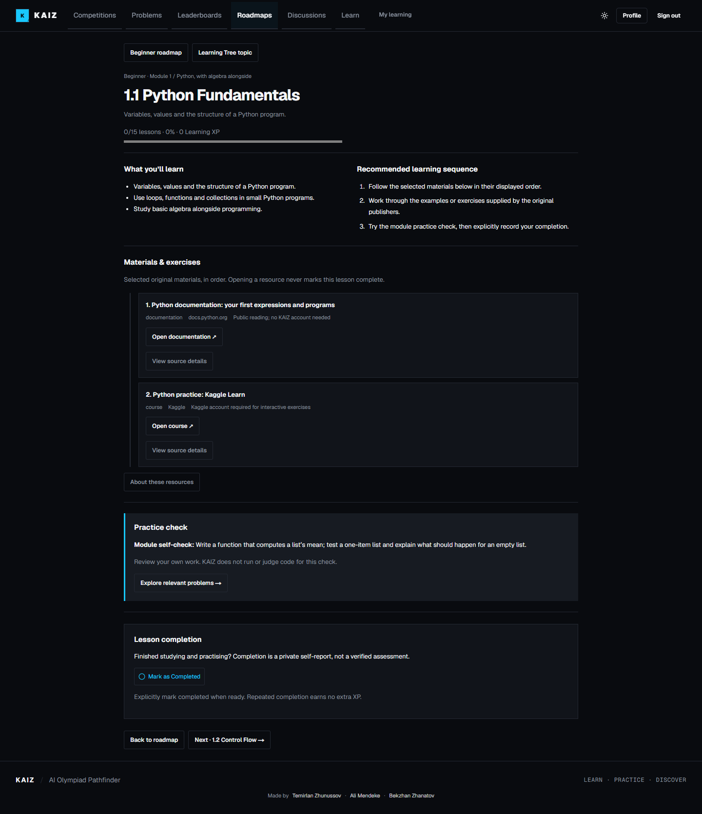

# Roadmap and lesson experience

Issue #38. Roadmap directory and dashboard Start / Continue / Review actions
always open the selected overview. The overview retains real completion counts,
module/lesson numbering, checkmarks and free lesson selection. Its separate
Start first lesson / Continue with next lesson control opens the next incomplete
lesson. Navigation alone never changes progress.

All 40 lessons share one layout: compact context and real saved progress,
student-facing objectives, ordered learning sequence, indented numbered original
material cards, existing module practice check, and one end-of-content completion
panel. Previous/next and back-to-roadmap links remain available. Materials use
actual curated titles and URLs; Kaggle Python stays labelled as a course, not an
invented Hello Python deep link. Provenance/access details are separate disclosures;
unverified/unavailable materials have warnings and no active action.

Completion is explicitly self-reported. The existing authenticated RPC, owner-only
RLS, idempotent XP calculation, undo and dashboard invalidation are unchanged.
Guests and unavailable-data states do not claim stored progress. The light
first-visit default and explicit saved dark theme are preserved.

## Release boundary

This branch starts from post-PR #36 main and is independent of PR #37. No schema,
Auth, migration, package, global styling, production environment or data changes.
It requires only the already released learning-progress migration
202610150001. It does not include or apply the personal-practice migration
202610160001 or PR #24's competition-presentation migration 202610120001.

The authenticated integration test uses only the separately approved isolated
Supabase QA project plus localhost. Disposable synthetic accounts/tasks are
removed in finally blocks. A practice fixture's attempt timestamp is one minute
in the past to avoid cross-host clock skew; production validation is not relaxed.
PostgreSQL tests use a fresh loopback-only PostgreSQL 17 cluster.

## Review checklist

- Directory Start/Continue opens overview; next-lesson control is separate.
- Choose any lesson; completion is below materials and practice check.
- Complete, refresh, new login/session, undo: counts and XP reconcile.
- Keyboard disclosure/link navigation, 375/1440px, 100/200% text, both themes.
- Guests cannot save; other users cannot read or edit private progress.
- Existing Learn topics and My Learning remain linked and available.
- No production writes, migrations, merge or deployment during QA.

## Verification — 2026-10-17

Fresh npm ci, TypeScript, ESLint, 191 regression tests, optimized production build
and diff checks passed. Disposable PostgreSQL 17.7 passed 123 SQL assertions,
40-key curriculum reconciliation, new-connection persistence, concurrent retries
and undo. Migration files are unchanged.

Real isolated Supabase Auth + localhost browser QA passed: directory keyboard
Start to overview, explicit first/next lesson navigation, end-of-content completion,
refresh, logout/login and independent session persistence, XP/idempotency/undo,
dashboard, existing private score history, owner isolation and anonymous denial.
Two synthetic users and one task removed afterward. Guest browser checks passed
all 40 routes, module disclosures, keyboard, 375/1440px, 100/200% text and both
themes. Light first visit (including OS dark) and saved dark preference passed.
No physical second-device, SMTP or production-write testing is claimed.

Review screenshots use the localhost QA build and disposable/guest sessions:

